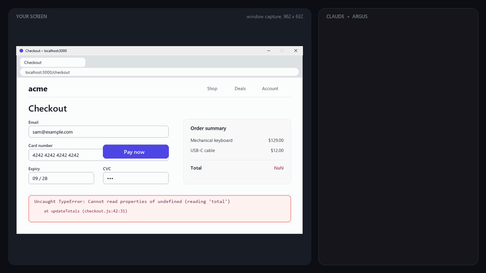

# Argus

[](https://github.com/sahildayal/argus/actions/workflows/ci.yml)
[](https://pypi.org/project/argus-screens/)
[](https://github.com/sahildayal/argus/blob/main/LICENSE)

Eyes for your AI tools across every monitor. Argus is an MCP server (plus a CLI and
a tray app) for Windows that lets Claude Code, Claude Desktop, VS Code, Codex,
Gemini CLI, Antigravity and other MCP clients see your screens. That covers the
window you're looking at, any monitor, any window or any region, at full
resolution when it matters.



<sub>Built from real Argus output on demo windows and a real Claude reply ([how](https://github.com/sahildayal/argus/blob/main/docs/make_demo.py)).</sub>

> Named after Argus Panoptes, the hundred-eyed giant: one eye per monitor.

## What you can say

| You say | The AI calls |
| --- | --- |
| "Look at this", "what's wrong on my screen?", "fix what I'm looking at" | `look`: the window you were just in. The terminal/IDE you're chatting from is skipped. |
| "Check my right monitor", "screenshot the laptop screen", "show me all screens" | `screenshot(monitor="right" / "laptop" / "all")` |
| "Look at the Chrome window with localhost:3000" | `screenshot(window="localhost:3000")` |
| "Look at my snip" (after Win+Shift+S) | `latest_snip` |
| *(press Ctrl+Alt+S over a window)* "look at what I marked" | `look` (a fresh mark wins) / `latest_mark` |
| "What does that error say exactly?" | `read_text` (Windows OCR, offline) or `zoom` |
| "Where's the Submit button?" | `find_text("Submit")` |
| "Wait until the build finishes, then check it" | `wait_for(until="text", text="Compiled successfully")` |
| "Did my CSS change break the page?" | `save_baseline` → change → `compare(baseline=...)` |

## Install

You need **Windows 10 (1903+) or 11**, [uv](https://docs.astral.sh/uv/getting-started/installation/),
and at least one MCP-capable AI tool.

```powershell
uv tool install argus-screens --managed-python --python 3.13
argus install      # registers Argus with the AI tools it finds; starts the tray app with Windows
argus doctor       # checks monitors, OCR, the tray and each registration
```

To run the latest unreleased code, install from GitHub instead:
`uv tool install git+https://github.com/sahildayal/argus --managed-python --python 3.13`.

Then open a **new** session in your AI tool and say *"look at what I'm looking at"*.
Running sessions don't pick up new MCP servers, and Claude Desktop needs a quit and reopen.

`argus install` configures whichever of these it finds, using each tool's own
`mcp add` command where it has one:

| Tool | How it's registered |
| --- | --- |
| Claude Code | `claude mcp add -s user argus ...` |
| Claude Desktop | `%APPDATA%\Claude\claude_desktop_config.json` |
| VS Code (Copilot agent mode, MCP extensions) | `%APPDATA%\Code\User\mcp.json` |
| Codex CLI | `codex mcp add argus ...` |
| Gemini CLI | `gemini mcp add -s user argus ...` |
| Antigravity | `agy mcp add argus ...` |

JSON files are backed up first (`*.bak-argus-<time>`). Your AI tools will **ask before
each capture** by default. `argus install --trust` pre-approves Argus in Claude Code
and Gemini CLI instead. Other options: `--clients claude-code,vscode`,
`--no-startup` and `--dry-run`. `argus uninstall` reverses everything.

**Other MCP clients** (Cursor, Windsurf, Zed, JetBrains, Cline, ...): add a stdio
server that runs `argus-mcp`. Use the full path, which `where.exe argus-mcp` prints:

```json
{ "mcpServers": { "argus": { "command": "C:\\Users\\YOU\\.local\\bin\\argus-mcp.exe" } } }
```

**Updating:** `uv tool upgrade argus-screens` (for a GitHub install, re-run the install command with `--reinstall`).

> Use a uv-managed Python (the `--managed-python` flag), not the Microsoft Store one:
> Store Python silently redirects writes under `AppData` into a private sandbox, so
> edits to other apps' configs would never reach them.

**Locked-down or offline machine?** Argus can run on an already-installed Python 3.12+
(python.org or winget, not the Store build), from pinned dependency versions, or from an
offline wheelhouse with checksums, and the guide lists what it writes to disk and which
Windows APIs it uses, for IT review: [docs/enterprise-install.md](https://github.com/sahildayal/argus/blob/main/docs/enterprise-install.md).

## How "the window I'm looking at" works

When you type into a terminal or IDE, *that* window has focus, so it can't be
the answer. Argus keeps a per-session history of which windows had focus and works
out which program launched it (Windows Terminal, VS Code, Claude Desktop, ...). `look` then picks:

1. a **hotkey mark** you made in the last 2 minutes, if any;
2. otherwise the **active window**, if it isn't the chat itself (you switched after typing);
3. otherwise the **window you used just before switching to the chat**;
4. otherwise the **front-most other window**.

It always says why it chose that window and lists alternatives (for example the
window under your mouse), so the AI can correct course.

## Monitors

Monitors are numbered **left to right** (main row first, then any monitor above
or below), and each also answers to a position word worked out from your actual
layout: `left`, `center`, `right`, `center-left`, `top`, `bottom`, `top-left`...
Also: `primary`, `laptop`, `cursor` (where the mouse is), `active` (where the
focused window is), part of the model name (`dell`), or `all`. Mixed scaling and
monitors left of/above the primary (negative coordinates) are handled; the
layout is re-read on every call, so plugging and unplugging is fine.

## Tools (MCP)

| Tool | What it does |
| --- | --- |
| `look` | What you're looking at (see above). `scope="monitor"` for its whole monitor. |
| `screenshot` | A monitor, a window (covered windows render themselves), or a region; nothing = every monitor. |
| `zoom` | Full-resolution crop of an earlier capture by `box` or grid `cell` ("D7", "B2:D5"). Small areas are enlarged. |
| `list_screens` | Monitors and windows front to back, with handles and focus history. Text only, cheap. |
| `latest_snip` | Your newest Win+Shift+S / Snipping Tool / PrtScn snips, or a copied image. |
| `latest_mark` | Your newest hotkey mark (window or its monitor). |
| `read_text` | OCR text with positions (Windows' built-in engine, offline). |
| `find_text` | Where text is on screen, with a zoomed image of the best match. |
| `save_baseline` / `compare` | Visual regression: numbered red boxes around every change. |
| `wait_for` | Wait for `change`, `stable`, `text` or `text_gone`, then screenshot. |

Images are sent at up to **2000 px** on the long side. A 1080p monitor goes
through untouched, and long sessions full of screenshots stay inside the
API's limits for requests with many images. Every capture that is sent is also
saved as a full-resolution PNG (path in the reply) with its metadata embedded, so
`zoom` can reopen it later by path. When approval is on, nothing is written to
disk until you approve it: a denied or timed-out capture is never saved.

## Tray app and hotkeys

`argus-tray` runs in the notification area (and starts with Windows after `argus install`).

- **Ctrl+Alt+S**: mark the window under the mouse (falls back to the focused
  window). A cyan outline flashes to show what was captured; the next `look`
  uses it.
- **Ctrl+Alt+P**: pause or resume Argus. While paused, every tool in every AI
  app refuses to capture (and the icon turns grey with a red slash).
- **Approvals**: when approval is on (always in the work profile), the tray shows
  the preview of each share and waits for **Send**, **Deny** or **Send & trust**
  (see [Approve sharing from the tray](#privacy-and-security)). Without a running
  tray, every capture that needs approval is refused.
- Menu: **Pause captures**, **Pause for 15 minutes**, **Profile** (Personal /
  Work; the tooltip shows which one is on), **Revoke trust** (ends any "Send &
  trust" grant now), **Open captures folder**, **Open marks folder**, **Open
  audit log folder**, **Edit settings** and **Quit Argus tray**.

The tooltip also warns when the work profile was kept on, when config.toml has
problems, and when approvals are unavailable (the tray also shows a notification
if its approval pipe can't start, usually because another Argus tray, such as
an older version, is still running). Change the hotkeys in
`~/.argus/config.toml`, then restart the tray.

## Privacy and security

Argus gives AI tools sight of your screens, so it's built to make that a
deliberate choice:

- **Two profiles.** *Personal* (the default) uses a block list: everything is
  visible except the windows listed below. *Work* uses an allow list: only the
  apps and browser tabs you allow are visible. The desktop, the taskbar, every
  other window and any area no window covers are blacked out. Their titles
  never leave Argus either, because a title alone can be confidential (say,
  `Doe, John (MRN 123456)`). Lists, captions and error messages name hidden
  windows as `<App> (hidden, work profile)`, and the AI can't capture them by
  name or match them by title. Use the work profile wherever your screens can
  show patient, customer or other regulated data. Switch with the tray menu or
  `argus profile work` / `argus profile personal`, and set what's allowed
  under `[work]` in `~/.argus/config.toml`:

  ```toml
  [profile]
  active = "work"

  [work]
  allow_apps = ["Code.exe", "WindowsTerminal.exe"]   # exe names
  ```

  **`allow_apps` is the boundary to rely on.** `allow_browser_titles` (and
  `allow_titles`) match the window title, and a browser's title is the
  active page's `<title>`, which the page itself controls: any website can
  call itself "localhost" or "Jira" and be shown. Treat title rules as a
  convenience for low-stakes cases, never as a security boundary. If you need
  strict control over which web apps the AI can see, run your work tools in a
  dedicated browser (or a separate browser exe/profile used only for them)
  and allow that program by exe name instead, keeping your everyday browser
  off the list.

  The block list below still applies on top of the allow list. In the work
  profile `latest_snip` only reads a bitmap on the clipboard, because a snip
  can't be redacted. `allow_snip_folder = true` adds the Screenshots folder
  and, separately, `allow_clipboard_files = true` adds image files copied in
  Explorer. Snips are never stamped as work captures, so they can't be
  reopened (or zoomed) later as verified ones, and while the work profile is
  locked down (see below) `latest_snip` is refused. Captures, marks and
  baselines are stamped with the profile, a hash of the allow/block lists and
  Argus's redaction version, and sealed with a per-install key
  (`~/.argus/seal.key`, re-read on every check: delete it and every old seal
  stops verifying). So the work profile only shows again images it redacted
  under its *current* settings: nothing from the personal profile, from before
  you changed the lists or upgraded the masker, or from a file Argus didn't
  write. Mark captions come from the sealed image, not the mark's JSON file.
  In the work profile `zoom`, `read_text` and `find_text` only reopen Argus
  capture ids or files inside `~/.argus/captures`, `marks` or `baselines`;
  any other path is refused.

  Once switched on (tray, `argus profile work`, or `active = "work"` in the
  file), work **stays on** until you switch it off with the tray or `argus
  profile personal`: Argus records the choice in `~/.argus/profile.state`, so
  an emptied, deleted, mangled or hand-edited `config.toml` can't quietly drop
  you back to personal. `argus status` and the tray tooltip say why work is on.

  The work profile fails closed. A `config.toml` that doesn't parse, an
  unknown profile name, a setting of the wrong type or a broken regex in
  `[profile]`, `[privacy]` or `[work]`, or an unknown section that looks like
  a misspelling of one of those or of `[gate]` / `[audit]` (`[profiles]`,
  `[privcy]`, `[audti]`),
  switches to the work profile with nothing allowed until you fix it (`argus
  status` and the tray tooltip say what's wrong). Windows that might be
  drawing on top of an allowed one - see-through or click-through overlays,
  popups and owned windows whose owner chain doesn't lead back to an allowed
  window, UWP apps whose process can't be identified - are blacked out, as are
  the rounded corners of allowed windows. An allowed window that is
  translucent (a layered window without a provable alpha of 255, including
  per-pixel-alpha windows) is blacked out whole, since what's behind it could
  show through, and so is a shaped window (one with a window region) unless
  Argus can prove it's opaque. Every work capture computes the redaction mask from the window
  list before and after grabbing the pixels; unless the two masks are
  identical, Argus retries and then refuses rather than risk a mask that
  doesn't match the pixels. It isn't perfect: a window that appears and
  vanishes entirely between those two looks can still slip through, which is
  what the approval preview below is for, so keep reviewing what you share.

- **Approve sharing from the tray.** In the work profile, the Argus tray queues
  requests from all MCP clients and shows one always-on-top preview at a time.
  Review the image and text tabs, then choose **Send**, **Deny** (or Esc), or
  **Send & trust** (trust these windows for `trust_minutes`, 10 by default)
  where available. Send and Send & trust only arm a moment after the preview
  gets focus, so a keystroke meant for another window can't approve it; Enter
  leaves the request pending. A timeout declines the share. Nothing is saved
  to disk until you approve: a denied or timed-out capture is discarded
  (baselines are still saved locally when you ask for one). If approval is
  unavailable, the AI is told so and the capture is refused: start or restart
  `argus-tray`; if you upgraded Argus, quit the old tray first; if
  `config.toml` has problems, `argus status` lists them. `argus status` also
  says whether the tray's approval pipe is reachable and verified. If the
  settings change while a request is in flight (you edit `config.toml`, pause,
  or switch profiles), the call stops with "Argus settings changed during the
  call; try again" (`settings_changed`).

  ```toml
  [gate]
  # enabled = true  # opt in to approvals in personal; work always asks
  timeout_seconds = 30
  trust_minutes = 10
  ```

  Trust follows the allowed window handles and their processes. If the visible
  allowed windows are a subset of the approved set, a matching capture can
  pass for that duration. A new window triggers a review. Content or tabs can
  change inside a trusted window. Use **Revoke trust** on the tray menu to end
  the grant. Pausing, switching profiles, or restarting the tray clears it.

  | MCP tool | Approval when the gate is on |
  | --- | --- |
  | `screenshot`, `look` | Review rendered images and all captions and leads. Live window scopes can use trust. |
  | `list_screens` | Review the exact inventory text each time. A paused status has no screen data. |
  | `latest_snip`, `latest_mark` | Review images and text each time. A saved or clipboard image has no live trust scope. |
  | `zoom`, `read_text`, `find_text` | In the work profile, always a fresh review showing the exact crop or OCR text that would be sent, even when the source image was shared before. In personal with the gate on, a source image already shared by this MCP server under the current settings doesn't need a second review. Approving OCR text alone doesn't authorize the source image. |
  | `compare` | Review the diff and captions, including a text-only no-change result. A comparison can take one fresh frame. |
  | `wait_for` | Review once per consecutive window set. When the set changes, review the previous frame before the watch continues. Review the exact final result before it is sent. The watch clock stops during interim review. |
  | `save_baseline` | Save locally and return a receipt with the baseline name. |

  In the work profile the CLI capture commands (`argus shot`, `look`, `zoom`,
  `ocr`, `find`, `wait`, `baseline compare`, ...) go through the same tray
  approval and audit log as MCP calls, so an AI agent that can run shell
  commands can't use the CLI to get around the gate. Tray previews travel through a local Windows
  pipe restricted to the current user and scoped to their session. Argus checks the pipe
  server's process and user before sending anything. Software already running
  as your Windows user can still tamper with the tray, its files or its input.
  Captures continue to use local storage and the configured retention period.
- **Audit log of gate decisions:** In the work profile (and in personal when
  opted in via `[audit] enabled = true`), every gate decision appends a JSON line
  to `~/.argus/audit/audit-YYYY-MM.jsonl`.
  - **What's logged:** timestamp (UTC ISO 8601), active profile (`work` or `personal`),
    tool name, decision (`sent` or `denied`), reason (`user`, `trusted`, `timeout`,
    `tray_unavailable`, `denied`, `not_required`, `audit_failed`), app executable names
    only, image count, SHA-256 hashes of the exact image bytes sent (so an auditor can
    later verify whether a specific image was or wasn't sent, without storing it),
    length of returned text in characters, request ID, the client (a canonical product
    id such as `claude-code`, or `other:<hash>` for a client name Argus doesn't know, so
    a client can't write arbitrary text into the log), Argus version, and a
    tamper-evidence hash chain (`prev` = SHA-256 of the previous line, chaining across
    monthly files).
  - **What is NEVER logged:** window titles, OCR text, file paths of captures,
    image pixels, or returned text content.
  - **Fail closed:** if audit logging is enabled and the audit file cannot be written,
    the gate decision fails closed (becomes `denied` with reason `audit_failed`), and
    an MCP error is returned saying the audit log could not be written.
  - **Tamper evidence:** `argus audit verify` checks the hash chain across files and reports
    the first broken line, with a plain-language explanation of each problem. Argus also
    records the newest entry in `audit/head.json`, so verify notices when entries are
    missing from the end of the log (a truncated tail), and `audit/anchor.json` records
    where retention pruned the chain, so a month deleted by hand is reported too. This is
    tamper *evidence* that catches accidental loss and casual edits, not cryptographic
    protection: anyone who can write files as you (or an administrator) could rewrite
    the history, `head.json` included.
  - **Retention & management:** monthly audit files are kept for 12 months by default
    (`retention_months = 12` under `[audit]`) and cleaned up during the existing retention
    pass. Audit logs are not deleted by `argus cleanup --all` or capture retention.
    Inspect entries with `argus audit` (newest 20; `-n 50`, `-n 0` for all), filter with
    `argus audit --since 2026-11-01` (a UTC date; `-n` still applies), verify with
    `argus audit verify`, or export with `argus audit export --out compliance.jsonl`
    (`--since` works before or after `export`). All times in the log are UTC.
    The tray also includes an "Open audit log folder" menu item.
- **Blacked out before anything leaves Argus:** password managers, WhatsApp,
  Signal, Telegram, Messenger, Phone Link, Windows notification toasts, and
  browser tabs whose titles match banking/payments/messaging patterns. The AI
  sees a dark box saying "Hidden by Argus" and never the title. The defaults are
  a starting point, so add your own bank, sites, apps or keywords under
  `[privacy]` in `~/.argus/config.toml`. Chrome doesn't put "Incognito" in its
  window title, so private windows can't be detected automatically.
- **Pause** with Ctrl+Alt+P, the tray menu, or `argus pause [--minutes N]`.
- **Retention:** saved captures and marks are deleted after 7 days by default.
  Baselines are kept until you delete them.
- **Where images go:** only to the AI tool that asked for them, and so to that
  tool's model provider (Anthropic, OpenAI, Google, ...). Argus itself never
  uploads anything, has no telemetry, and makes no network requests.
- **Prompt injection:** anything on screen is input to the agent. A web page or
  document could try to steer an agent into capturing something. Keep
  per-capture prompts on for sensitive work and pause Argus when needed.

Everything personal lives in `~/.argus/` (settings, captures, marks, baselines and
logs), never in this repository. Set `ARGUS_HOME` to move it.

## CLI

The CLI is useful for scripts and tests, and for any agent that can run shell
commands but doesn't speak MCP. It prints the saved PNG path for each capture;
add `--json` for machine-readable output.

```powershell
argus list                                   # monitors + windows
argus look                                   # the window behind this terminal
argus shot -m right --grid                   # a monitor, with a labeled grid
argus shot -w "localhost:3000" -o page.png   # a window, copied to page.png
argus zoom $env:USERPROFILE\.argus\captures\<date>\<file>.png --box 100,100,600,400
argus ocr -w "Windows Terminal"              # exact text
argus find "Submit" -m cursor
argus wait text --text "Compiled successfully" -w "Terminal" -t 120   # exit 0 = seen, 1 = timeout
argus baseline save login -w "localhost:3000"; argus baseline compare login
argus pause --minutes 30; argus resume; argus status
argus profile; argus profile work             # show / switch the privacy profile
argus allow                                   # show the work allow list
argus allow --learn                           # pick from apps with windows open now; titles never shown
argus allow add Code.exe WindowsTerminal.exe
argus allow remove Code.exe
argus allow add-title '^Jira'                 # match any window title
argus allow add-title '\blocalhost\b' --browser   # match browser tab titles
argus allow remove-title '^Jira'
argus audit                                   # the newest 20 gate decisions (UTC)
argus audit --since 2026-11-01 -n 50          # the newest 50 since a UTC date
argus audit verify                            # check the hash chain for tampering
argus audit export --out compliance.jsonl     # export the audit log
```

`argus allow` edits the `[work]` lists in `~/.argus/config.toml`. It adds and
removes entries in the file as you wrote them (spelling, order and comments are
kept), takes a lock so two edits at once can't undo each other, and refuses to
write if the file changed meanwhile or if `config.toml` has any problem (it
prints them; fix them first). Plain `argus allow` shows the lists as written,
plus any config problems, and says when a lockdown makes them ineffective.
Learn mode lists the friendly and executable names of apps that have windows
open right now; it never captures a screenshot or prints window titles. Use
`--browser` with `add-title` or `remove-title` for browser tab patterns. In
PowerShell, single quotes keep a regex as typed (`'\blocalhost\b'`).

## Settings: `~/.argus/config.toml`

Created with comments on first run. You can set the image size sent to the AI,
the grid default, the mouse marker, how fresh a mark must be for `look`, the
hotkeys, retention, the privacy profile and its block and allow lists, and:

- `[gate]`: `timeout_seconds` (how long a preview waits, default 30) and
  `trust_minutes` (how long **Send & trust** lasts, default 10). `enabled = true`
  turns approvals on in the personal profile; the work profile always asks,
  whatever it says.
- `[audit]`: `retention_months` (default 12). `enabled = true` turns the audit
  log on in the personal profile; the work profile always logs.

Values are type-checked: a wrong type (say `enabled = "true"` instead of
`enabled = true`) or an unknown key is reported by `argus status` and the
default is used. Changes apply on the next capture; hotkey changes need a tray
restart.

## Recommended work setup

For a workplace where screens can show patient or other regulated data:

1. `argus profile work`, then `argus allow --learn` to pick the apps the AI may
   see (or `argus allow add Code.exe ...`). Prefer apps over title patterns.
2. Keep `argus-tray` in Startup (`argus install` adds it) and running: in the
   work profile every share needs your approval in the tray, and without it
   every capture is refused.
3. Run `argus status` (or `argus doctor`): it should say the approval gate and
   audit log are on, the approval pipe is reachable and verified, and there are
   no config problems.
4. Stop the AI tool from reading Argus's files or driving the CLI itself, so
   the MCP tools (and their approvals) are the only way in. In Claude Code, add
   deny rules to `~/.claude/settings.json` (example; adjust paths if you set
   `ARGUS_HOME`):

   ```json
   {
     "permissions": {
       "deny": [
         "Read(~/.argus/**)",
         "Edit(~/.argus/**)",
         "Bash(argus *)",
         "Bash(argus-tray *)"
       ]
     }
   }
   ```

   `Read`/`Edit` rules use gitignore-style paths (`~/` is your home folder);
   `Bash(argus *)` blocks commands that start with `argus`. Bash rules match
   command text, not intent, so they are a guard rail, not a sandbox: a command
   written another way can still run. That's why the work profile also routes
   CLI captures through the tray approval and the audit log, and refuses to
   reopen files outside `~/.argus`. Other AI tools have similar permission
   settings; check their documentation.
5. Check the log now and then with `argus audit` and `argus audit verify`.

What changes in the work profile, in short:

- Only allowed apps are visible; everything else is blacked out without titles,
  and shaped or translucent windows are blacked out unless provably opaque.
- Every share is previewed in the tray; `zoom`, `read_text` and `find_text`
  always ask again, showing the exact crop or text.
- Captures are written to disk only after approval; denied or timed-out ones
  are never saved. Baselines are saved only when you (or the AI) explicitly
  save one.
- CLI capture commands go through the same approval and audit log as MCP.
- Only Argus capture ids and files inside `~/.argus/captures`, `marks` or
  `baselines` can be reopened.
- If settings change mid-call, the call stops with "Argus settings changed
  during the call; try again" rather than sending a result made under the old
  settings.
- Every decision is logged with the client as a canonical id (or
  `other:<hash>`), and `argus audit verify` also detects a truncated log tail
  (accidental loss, not a determined local attacker).

## Troubleshooting

- **Start with `argus doctor`.** It checks DPI awareness, monitors, OCR, the
  profile, the approval gate and audit log, whether the tray is running and its
  approval pipe is reachable and verified, the Startup shortcut, config
  problems and each registration. `argus status` shows the same approval, audit
  and tray lines without the slower checks.
- **"Approval is unavailable".** Start or restart `argus-tray`. If you upgraded
  Argus, quit the old tray first (tray menu > Quit Argus tray): an older tray
  listens on a different approval pipe. If `config.toml` has problems, see
  `argus status`.
- **The AI doesn't see Argus.** Start a new session. In Claude Code,
  `claude mcp get argus` should say *Connected*.
- **A hotkey does nothing.** Another app may own it, in which case the tray shows
  a warning when it starts. Pick another in `config.toml` and restart `argus-tray`.
- **Small text looks blurry.** Ask the AI to `zoom` or `read_text` instead of guessing.
- **Logs:** `~/.argus/logs/server.log` and `~/.argus/logs/tray.log`.

## Uninstall

```powershell
argus uninstall [--purge]     # unregisters everywhere, removes the startup entry, stops the tray
uv tool uninstall argus-screens
```

## Contributing

Issues and pull requests are welcome. See [CONTRIBUTING.md](https://github.com/sahildayal/argus/blob/main/CONTRIBUTING.md) for
setup, the two test suites, and the ground rules (tests never capture the real
screen; privacy defaults stay conservative).

## License

[MIT](https://github.com/sahildayal/argus/blob/main/LICENSE)
